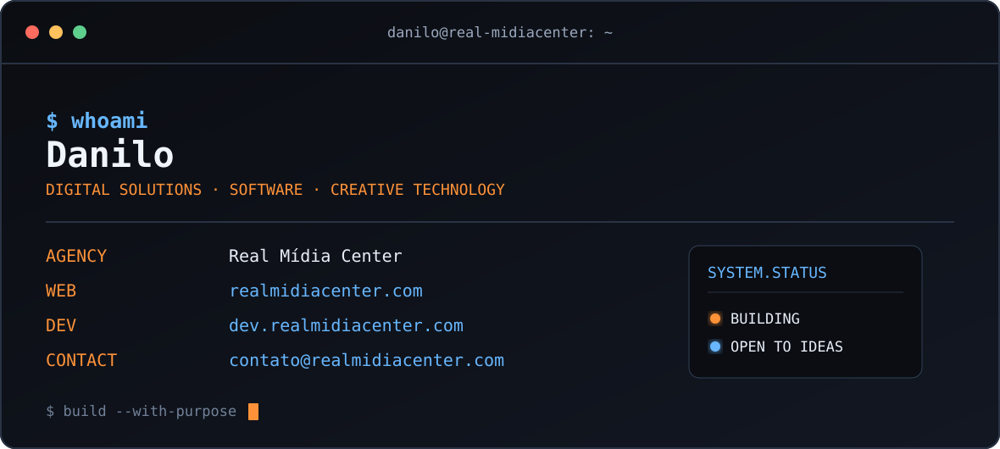

  

   
   

  
  
  

 

<table>
<tr>
<td width="35%" valign="middle" align="center">

</td>
<td width="65%" valign="middle">
<h3>Olá, eu sou Danilo.</h3>

Sou desenvolvedor web e fundador da <strong>Real Mídia Center</strong>, criada em 2021. Desenvolvo sites em WordPress e sistemas personalizados com PHP e JavaScript, incluindo ferramentas para gestão de clientes, contratos e automação de processos.

Meu trabalho tem foco em performance, segurança e SEO técnico.

</td>
</tr>
</table>

## Tecnologias

**WordPress · PHP · JavaScript · HTML · CSS**

Atuo na criação de sites profissionais, interfaces responsivas e sistemas web sob medida, com integrações, automações e otimização de desempenho.

## Projetos

### RMC Client Manager

Sistema de gestão de clientes que reúne dados, documentos, acessos e informações importantes para a operação.

[Conhecer o sistema](https://labs.realmidiacenter.com/rmc-client-manager-ultra-senior-edition/)

### RMC Legal Engine

Sistema para criação, organização e gerenciamento de contratos, desenvolvido para facilitar processos de gestão documental.

[Conhecer o sistema](https://labs.realmidiacenter.com/rmc-legal-engine-contratos-quantum/)

## Real Mídia Center

Fundei a Real Mídia Center em 2021. Desenvolvo sites e soluções digitais personalizadas para empresas, com atenção à experiência de uso, segurança e desempenho.

Também compartilho conteúdos sobre desenvolvimento web, WordPress e SEO no [blog da Real Mídia Center](https://blog.realmidiacenter.com/).

## Contato

- [Site profissional](https://dev.realmidiacenter.com/)
- [Real Mídia Center](https://realmidiacenter.com/)
- [LinkedIn](https://linkedin.com/in/danilopacheco-realmidiacenter/)
- [contato@realmidiacenter.com](mailto:contato@realmidiacenter.com)

## GitHub em números

  
  

---

  Feito com propósito por Danilo · Real Mídia Center

